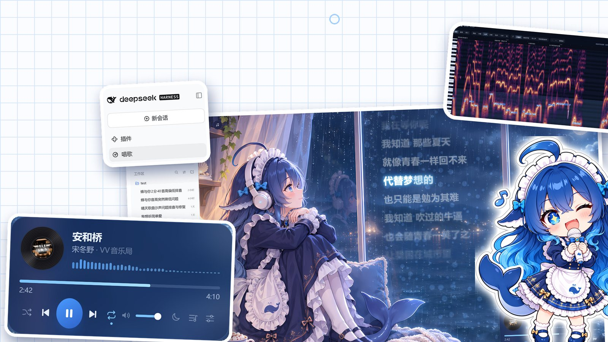
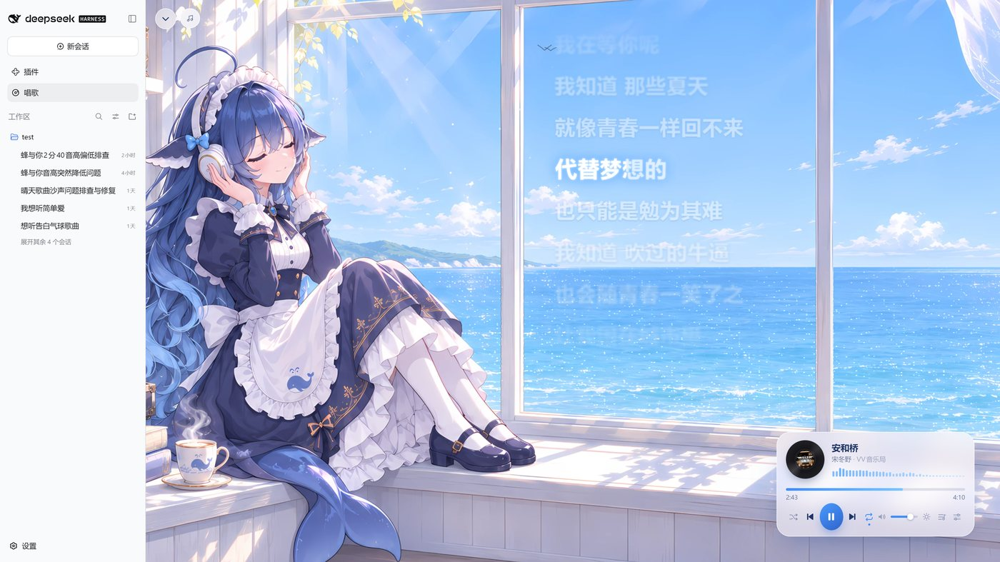
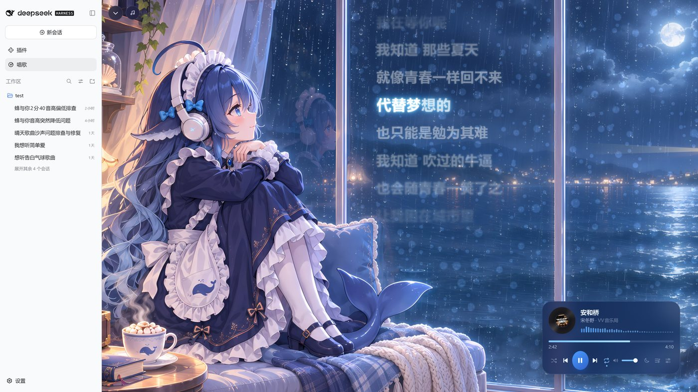
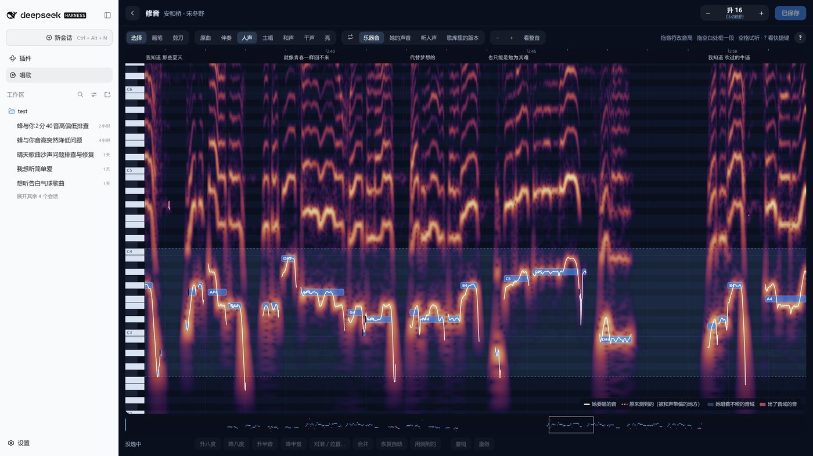

<div align="center">



# 🐟 dsh-singinglab · 大肥鱼唱歌实验室

**DeepSeek Harness 的唱歌插件：跟她说想听什么，她去 B 站学会，在你的电脑上唱给你听。**

[](https://www.npmjs.com/package/dsh-singinglab)
[](LICENSE)
[](https://github.com/deepseek-ai)
[](https://live.bilibili.com/26835777)

</div>

---

大肥鱼每天晚上在直播间唱歌，学会了六百多首。哑掉的、跑调的、突然掉八度的，我们一首一首听过来，把这些经验做成了这个插件：

- 🎤 **一句话点歌**：「我想听晴天」。她自己去 B 站找，学完就放给你听。
- 🎚️ **自动定调**：按这首歌的最低音和最高音，算出她唱得了的调，不再公鸭嗓。
- 🩹 **自动修音高**：学歌时会查出被和声拽低一个八度的地方，自动修好。
- ✍️ **修音页**：没修到的，在频谱上把音符拖回去；也可以直接跟她说「第二段副歌不对」。
- 🌊 **会动的播放器**：歌词映在窗玻璃上，海面跟着音乐闪光，夜里会下雨。
- 💻 **全在本地**：在你自己的显卡上学歌和唱歌，用的是你给她的声音。

## 🖼️ 长这样

<table>
  <tr>
    <td width="50%"></td>
    <td width="50%"></td>
  </tr>
  <tr>
    <td align="center"><sub>☀️ 白天：歌词映在窗上，跟着唱到的那句亮起来</sub></td>
    <td align="center"><sub>🌙 夜里：主题跟着系统走，也能在播放卡片上切换</sub></td>
  </tr>
</table>


<p align="center"><sub>✍️ 修音页：背景是这首歌自己的频谱。白线是她要唱的音，蓝色带子是她唱着不哑的音域。拖音符改音高，空格试听；右上角可以升降调。</sub></p>

## 🚀 安装

### 最省事：让 DSH 帮你装

在 DSH 里跟她说：

> 帮我装一下 dsh-singinglab 唱歌插件，装好后把学歌也准备好。

她会装好插件，然后重启。侧栏会多出 **「唱歌」**，里面是歌库和播放器。学歌要的环境和模型她也会自己装好。

整个过程只有一样东西要你给：**她的声音**，也就是一个 RVC 声音模型（`.pth`，最好带上同名的 `.index`）。告诉她文件在哪，或者拖进唱歌面板的「学歌设置」里。

### 命令行

```bash
dsh plugin --profile web add dsh-singinglab
```

### 要什么样的电脑

| | |
|---|---|
| 🎮 **显卡** | NVIDIA，显存 8 GB 以上比较稳。没有 N 卡也能学，但非常慢 |
| 💾 **磁盘** | 学歌环境约 5 GB；推荐配方的模型约 6.3 GB，快速配方不到 1 GB |
| 🖥️ **系统** | Windows 10 / 11 或 Linux |

<details>
<summary><b>🤖 给 DSH 的安装步骤（AI 照着做）</b></summary>

1. 用插件管理工具把 npm 包 `dsh-singinglab` 装到当前 profile（命令行等价于 `dsh plugin --profile web add dsh-singinglab`），然后重启 DSH。
2. 重启后侧栏会出现「唱歌」，每个会话都会多出 `singinglab_*` 工具（插件不带预设，不用换模式）。调 `singinglab_status` 看还缺什么。
3. 调 `singinglab_prepare` 装学歌环境：插件自己的 Python 3.11 + PyTorch，装在 `<DSH_HOME>/dsh-singinglab/engine`，不碰用户别的 Python。它还会下载推荐配方要的模型，全程走国内镜像，需要几分钟到半小时。进度用 `singinglab_status` 看。
4. 问用户要 RVC 声音模型的路径，用 `singinglab_import_voice` 导入。
5. 用户说想听什么：
   - 用 `singinglab_search` 找。
   - 用 `singinglab_learn` 学，学会了自动放。
   - 已经会唱的用 `singinglab_play` 放。

   不打开唱歌页面也能放出来。对话里的卡片上有「去唱歌」按钮，点了会切到播放器看歌词。

</details>

## 🎵 用起来

- **歌库**：她会唱的歌都在这里。搜一首她不会的，回车，她会去 B 站找；点「学这首」开始学。
- **播放器**：一张会动的壁纸，就是上面截图里那样。
- **修音**：在播放卡片上点调教按钮进去。
  - 频谱可以切换成原曲、伴奏、人声、主唱、和声、干声。
  - 试听可以切换成乐器音、她的声音、原唱人声、歌库里的版本。
  - 修完点保存。
- **学歌设置**
  - **一键准备**：缺什么补什么。
  - **她的声音**：可以放好几个，选一个用。
  - **高级**：
    - 配方：推荐、快速、自定义三种，每一步都能选做法，修音高和定调可以关。
    - 模型货架：每个模型是什么、多大、什么许可证。
    - 导入：用电脑里已有的模型文件。

### 学歌的九步

```
取音频 → 分离人声 → 拆主唱 → 去混响 → 对歌词 → 修音高 → 定调 → 换成她的声音 → 混音
```

推荐配方就是大肥鱼在直播里学歌用的那一套。

## 📜 第三方和许可证

- **插件本身**：[MIT](LICENSE)。
- **`engine/`**：两个项目的推理代码，都是 MIT，见 [`engine/NOTICE.md`](engine/NOTICE.md)：
  - [Applio](https://github.com/IAHispano/Applio)：RVC 推理。
  - [Music-Source-Separation-Training](https://github.com/ZFTurbo/Music-Source-Separation-Training)：人声分离。
- **模型**：各有各的许可证，写在 `assets/catalog.json` 和学歌设置的模型货架里。
- **B 站的音频**：学出来的歌只给你自己听，不要拿去商用或二次发布。

## 🛠️ 开发

```bash
npm install
node build.mjs     # 构建
npm test           # 测试
```

宿主端接口见 `src/index.ts` 开头的注释。

<div align="center">
<br>
<sub>想听她唱歌？晚上来 <a href="https://live.bilibili.com/26835777">B 站直播间</a> 点歌 🐟</sub>
</div>
